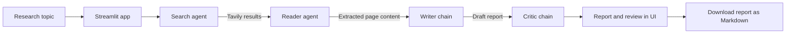

# Multi-Agent Research System

A Streamlit research assistant that turns a topic into a sourced report. Its
search, reading, writing, and review stages use specialized LangChain agents and
chains, with web search powered by Tavily and report generation powered by
OpenAI.

## Features

- Search the web for recent information using Tavily.
- Select a relevant search result and extract readable page content.
- Generate a structured research report with source URLs.
- Review the report and return strengths, improvement areas, and a score.
- View each pipeline stage in the Streamlit interface and download the report
  as Markdown.

## Requirements

- Python 3.14 or newer
- [uv](https://docs.astral.sh/uv/)
- An OpenAI API key
- A Tavily API key

## Installation

1. Install Python 3.14+ and uv if they are not already installed.
2. Clone the repository and enter its directory:

   ```bash
   git clone https://github.com/Sirish3/Multi-Agent-Research-System.git
   cd Multi-Agent-Research-System
   ```

3. Install the project dependencies:

   ```bash
   uv sync
   ```

4. Create a `.env` file in the project root and add your API keys:

   ```dotenv
   OPENAI_API_KEY=your_openai_api_key
   TAVILY_API_KEY=your_tavily_api_key
   ```

   Keep this file private; `.env` is excluded by `.gitignore`.

5. Start the app:

   ```bash
   uv run streamlit run app.py
   ```

   Streamlit prints a local URL to open in your browser. Enter a research topic
   and select **Run Research Pipeline**.

The application uses `gpt-4o-mini` by default. OpenAI and Tavily API requests
may incur charges under your provider accounts.

## How it works



1. The **Search Agent** uses the Tavily search tool to find relevant web
   results.
2. The **Reader Agent** chooses a relevant URL and uses the scraping tool to
   extract readable page content. Extraction tries Trafilatura first, then
   Readability and Beautiful Soup.
3. The **Writer Chain** combines the search results and extracted content into
   a structured report.
4. The **Critic Chain** evaluates the draft and returns a score, strengths,
   areas to improve, and a verdict.

The Streamlit app displays the stage results and offers the report as a
Markdown download. `src/pipelines/pipeline.py` exposes a callable pipeline for
non-UI use; `main.py` is a simple script entry point for it.

## Technologies

| Technology | Role |
| --- | --- |
| Python | Application language (3.14+) |
| Streamlit | Interactive web interface |
| LangChain and LangGraph | Agent/tool orchestration and prompt chains |
| OpenAI (`gpt-4o-mini`) | Language model for agent, report, and review tasks |
| Tavily | Web search |
| Requests | Fetching pages for scraping |
| Trafilatura, Readability, Beautiful Soup | Extracting readable page content |
| python-dotenv | Loading local API keys from `.env` |
| uv | Dependency and environment management |

## Project structure

```text
.
├── app.py                  # Streamlit application
├── main.py                 # Non-UI pipeline runner
├── pyproject.toml          # Project metadata and dependencies
├── uv.lock                 # Locked dependency versions
└── src/
    ├── agents/
    │   └── agents.py       # Search/reader agents and writer/critic chains
    ├── pipelines/
    │   └── pipeline.py     # Callable end-to-end research pipeline
    └── tools/
        └── tools.py        # Tavily search and URL scraping tools
```

## Contributing

Contributions are welcome. Open an issue to discuss a bug or proposed change,
or submit a pull request describing the change and how it was verified. Please
do not include API keys or other secrets in commits.

## License

This project is distributed under the MIT License. See [LICENSE](LICENSE) for
the full text.
